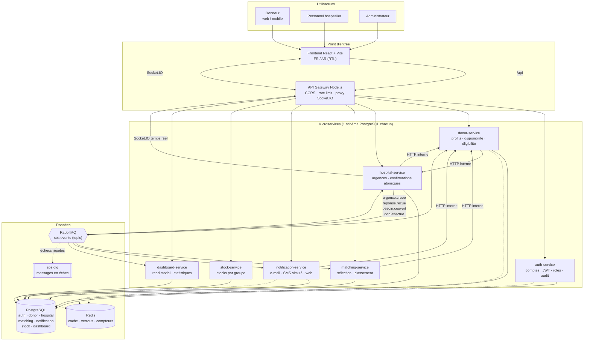
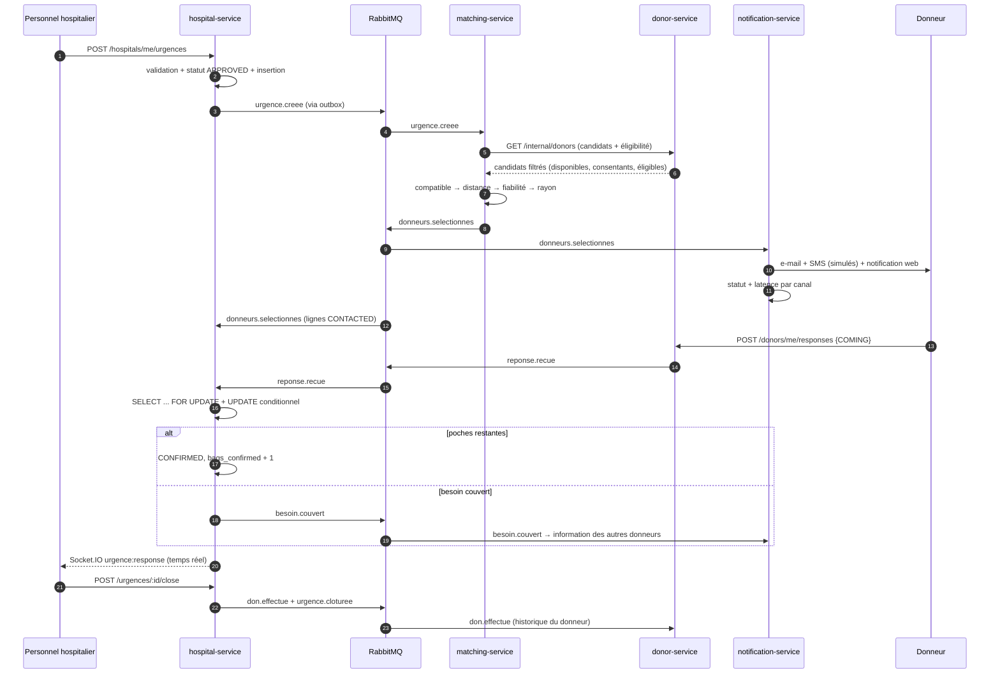

# Architecture — SOS Sang

## 1. Vue d'ensemble



## 2. Responsabilités

| Service | Port | Rôle | Ne fait pas |
|---|---|---|---|
| gateway | 8080 | routage, CORS, limitation de débit, suppression des en-têtes internes | aucune logique métier |
| auth | 4001 | comptes, hachage bcrypt, émission/validation JWT, rôles, validation des hôpitaux, audit | ne connaît pas les urgences |
| donor | 4002 | profils donneurs, consentements, éligibilité calculée, réponses aux alertes, dons reçus | ne décide jamais de la compatibilité d'une urgence |
| hospital | 4003 | profils hospitaliers, urgences, suivi des réponses, confirmation atomique, clôture, temps réel | n'accède pas aux profils donneurs complets |
| matching | 4004 | filtrage et classement des candidats, extension progressive du rayon | n'envoie aucune notification |
| notification | 4005 | persistance des notifications par canal, statuts, latence, renvoi manuel | ne décide pas qui alerter |
| stock | 4006 | stocks par groupe, seuils, mouvements | ne modifie pas les urgences |
| dashboard | 4007 | journal d'événements, agrégats publics et admin, santé des services | ne lit jamais un autre schéma |

## 3. Contrats d'événements

Enveloppe commune (`packages/shared/src/events.ts`) : `id`, `type`, `version`, `occurredAt`, `correlationId`, `producer`, `payload`.

| Événement | Producteur | Consommateurs | Contenu |
|---|---|---|---|
| `urgence.creee` | hospital | matching, dashboard | groupe, poches, priorité, échéance, localisation, hôpital |
| `donneurs.selectionnes` | matching | notification, hospital, dashboard | liste classée (donneur, distance, rang), rayon retenu |
| `reponse.recue` | donor | hospital, dashboard | urgence, donneur, réponse (`COMING` / `CANNOT`) |
| `besoin.couvert` | hospital | notification, donor, dashboard | poches nécessaires, confirmés, non retenus |
| `don.effectue` | hospital | donor, dashboard | dons réellement réalisés par donneur |
| `urgence.cloturee` | hospital | dashboard | statut final (`CLOSED` / `CANCELLED`) |

### Fiabilité

1. **Outbox transactionnel** : chaque service écrit l'événement dans sa table `outbox` *dans la même transaction* que la modification métier, puis tente une publication immédiate. Un relais (`startOutboxRelay`) republie toutes les 500 ms les lignes non publiées, avec compteur de tentatives et dernière erreur.
2. **Idempotence des consommateurs** : `processed_events(event_id, event_type)` + `processOnce()` (insertion avant traitement, suppression en cas d'échec pour permettre une nouvelle livraison).
3. **Reprise** : échange `sos.retry` + file `.retry` par consommateur (`x-message-ttl` 5 s, dead-letter vers `sos.events` conservant l'en-tête `x-attempt`), puis `sos.dlx` → `sos.dlq` après épuisement.
4. **Messages persistants**, accusés manuels, `prefetch` 10.

## 4. Flux d'une urgence



## 5. Confirmation sans doublon

Dans une transaction :

```sql
SELECT * FROM urgences WHERE id = $1 FOR UPDATE;
UPDATE urgency_responses SET status = 'CONFIRMED'
 WHERE urgency_id = $1 AND donor_id = $2 AND status = 'COMING'
 RETURNING id;                          -- une seule ligne possible
UPDATE urgences SET bags_confirmed = bags_confirmed + 1 WHERE id = $1;
UPDATE urgences SET status = 'COVERED' WHERE id = $1 AND status = 'OPEN';
```

Le verrou de ligne sérialise les réponses concurrentes ; la contrainte `UNIQUE(urgency_id, donor_id)` empêche les doublons structurels. Vérifié par test : 4 réponses simultanées pour 2 poches donnent exactement 2 confirmations.

## 6. Règles métier

### Compatibilité (module isolé, testé)

Matrice explicite globules rouges donneur → receveurs, exportée par `@sos/shared/blood`, couverte par 6 tests dont la vérification des 64 combinaisons. **Ne concerne que les globules rouges** : ni plasma, ni plaquettes, ni éligibilité médicale, ni décision clinique.

### Éligibilité (configurable)

`minIntervalDays` (90), `minAge` (18), `maxAge` (65), `minWeightKg` (50), surchargeable à chaud par un administrateur (`settings.eligibility_rule`). Produit `blockers`, `warnings`, `nextEligibleOn`, `daysUntilEligible` et un avertissement explicite : **résultat indicatif, pas une validation médicale**.

### Classement

1. Filtres éliminatoires : compatibilité, disponibilité, consentement, éligibilité, coordonnées présentes.
2. Tri : distance Haversine croissante, puis score de fiabilité décroissant
   `40·min(1, dons/10) + 30·(réponses/alertes) + 30·(venues/réponses)`.
3. Nombre d'alertes visé : `min(maxAlerts, max(3, poches × 4))`.
4. Extension progressive : rayons 25 → 50 → 100 → 200 km jusqu'à atteindre la cible ; indicateur `insufficient` si le besoin dépasse les donneurs trouvés.

## 7. Données et isolation

- Un schéma PostgreSQL par service, propriété exclusive du service.
- Aucune jointure inter-services, aucun accès direct au schéma voisin.
- Les échanges passent par HTTP interne (`x-internal-token`) ou par événements.
- Le service `dashboard` reconstruit une vue agrégée à partir des événements (CQRS léger) — il ne lit jamais `hospital` directement.
- En Docker Compose : une instance PostgreSQL, sept schémas (séparation logique). En production : une instance/cluster par service.

## 8. Sécurité

| Mesure | Mise en œuvre |
|---|---|
| Mots de passe | bcrypt coût 12, politique ≥ 10 caractères avec majuscule, minuscule, chiffre |
| Jetons | JWT HS256, émetteur `sos-sang`, expiration 12 h, vérification systématique |
| Rôles | middleware `requireRole` + filtrage par `hospital_id` pour les ressources hospitalières |
| Entrées | schémas zod sur chaque route, erreurs normalisées |
| Injection SQL | requêtes exclusivement paramétrées |
| CORS | liste blanche explicite, credentials autorisés |
| Débit | 10 connexions/15 min, 20 inscriptions/h, 300 requêtes/min à la gateway |
| Secrets | variables d'environnement, `.env` ignoré, `.env.example` factice |
| Audit | `audit_log` (connexion, échec, validation d'hôpital, changement de rôle, suppression) |
| Données personnelles | position arrondie et jamais publique, consentements explicites, anonymisation à la suppression |

## 9. Kubernetes et haute disponibilité

Namespaces : `sos-app` (applicatif), `sos-data` (PostgreSQL, Redis, RabbitMQ), `monitoring` (Prometheus, Grafana, Loki).

- Deployments avec `readinessProbe` / `livenessProbe`, demandes et limites CPU/mémoire, `maxUnavailable: 0` en RollingUpdate.
- StatefulSets + PVC pour PostgreSQL, Redis, RabbitMQ.
- HPA sur `hospital-service`, `matching-service`, `gateway` (nécessite `metrics-server`).
- NetworkPolicies : refus par défaut, ouvertures explicites (gateway → services, services → `sos-data`, DNS).
- Ingress TLS avec terminaison et affinité de session pour Socket.IO.
- Deux réplicas pour les services critiques en profil cible ; profil `local` (1 réplica) pour un PC.

**Ce que deux réplicas ne garantissent pas** : sur un cluster mono-nœud (Minikube, Kind), le matériel et le nœud unique restent des points de panne. Une haute disponibilité réelle exige au moins trois nœuds, un stockage répliqué, un PostgreSQL avec réplication et un contrôleur d'Ingress redondant.

## 10. Observabilité

- `/metrics` Prometheus sur chaque service (compteurs de requêtes, histogramme de latence, événements publiés/consommés, notifications par statut).
- Métriques suivies : requêtes/s, p95, taux d'erreur, files RabbitMQ, urgences traitées, délai de notification, redémarrages de pods.
- Alertes fournies : p95 > 500 ms, erreurs 5xx > 2 %, file > 500 messages, DLQ non vide, délai de notification > 10 s, pod redémarré, réplicas indisponibles.
- Grafana : tableau de bord provisionné automatiquement, sources Prometheus et Loki.
- Loki + Promtail pour la centralisation des journaux ; `requestId` propagé de la gateway jusqu'aux services pour corréler une requête.
